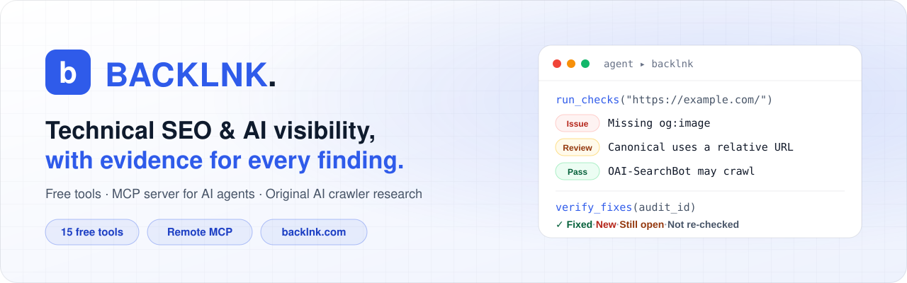
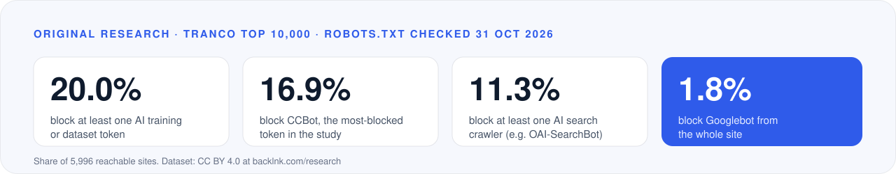

<a href="https://backlnk.com">
  <picture>
    <source media="(prefers-color-scheme: dark)" srcset="https://raw.githubusercontent.com/BACKLNK/.github/main/profile/assets/banner-dark.svg">
    
  </picture>
</a>

<p align="center">
  <a href="https://backlnk.com"></a>
  <a href="https://backlnk.com/tools"></a>
  <a href="https://github.com/BACKLNK/backlnk-mcp"></a>
  <a href="https://registry.modelcontextprotocol.io/v0/servers?search=com.backlnk"></a>
  <a href="https://backlnk.com/research/ai-crawler-access-2026-11"></a>
</p>

**Backlnk** ([backlnk.com](https://backlnk.com)) is a free technical SEO and AI-visibility platform. It runs real
checks on real pages (meta tags, structured data, robots.txt access for AI crawlers, redirects, sitemaps, indexability,
hreflang, internal links, page speed and more) and shows the evidence behind every finding: the URL, the exact excerpt
and where it was found. It helps websites be found in search engines and in AI answers (SEO, AEO and GEO), and it gives
AI coding agents the same checks through an MCP server.

## What you can do with Backlnk

| | What it does |
| --- | --- |
| **[Free SEO & AI-visibility tools](https://backlnk.com/tools)** | 15 checks on your live pages: no sign-up, saved reports, findings most important first. |
| **[Free full website audit](https://backlnk.com/tools/full-audit)** | Every check on one website, delivered as one PDF report by e-mail with a private online version. |
| **[MCP server & API for AI agents](https://github.com/BACKLNK/backlnk-mcp)** | Claude Code, Cursor or VS Code check a page, fix the code and verify the fix. Free key, 100 checks a day. |
| **[AI Crawler Policy Builder](https://backlnk.com/tools/ai-crawler-policy)** | Allow AI search, block AI training: the exact robots.txt lines, explained per vendor. |
| **[Free site monitor](https://backlnk.com/tools/site-monitor)** | A weekly check of robots.txt, noindex, redirects and the sitemap, with an e-mail when something changes. |
| **[Research & open data](https://backlnk.com/research/ai-crawler-access-2026-11)** | How the 10,000 most popular websites treat AI crawlers, with the full dataset under CC BY 4.0. |

## The free tools

| Search & indexing | AI visibility & content | Site structure & performance |
| --- | --- | --- |
| [Meta Tags & Social Preview](https://backlnk.com/tools/meta-tags-checker) | [AI Crawler Access Checker](https://backlnk.com/tools/ai-crawler-access-checker) | [Internal Link Analyzer](https://backlnk.com/tools/internal-link-analyzer) |
| [Indexability Checker](https://backlnk.com/tools/indexability-checker) | [llms.txt Generator & Validator](https://backlnk.com/tools/llms-txt) | [Page Structure & Readability Auditor](https://backlnk.com/tools/page-structure-auditor) |
| [Redirect & HTTP Header Checker](https://backlnk.com/tools/redirect-header-checker) | [Answer Snippet Extractor](https://backlnk.com/tools/answer-snippet-extractor) | [Duplicate & Thin Content Finder](https://backlnk.com/tools/duplicate-content-finder) |
| [Sitemap Hygiene Auditor](https://backlnk.com/tools/sitemap-auditor) | [Entity Signal & Schema Checker](https://backlnk.com/tools/entity-schema-checker) | [Image SEO Audit](https://backlnk.com/tools/image-seo-audit) |
| [Hreflang Validator](https://backlnk.com/tools/hreflang-validator) | [Intent & Service Focus Analyzer](https://backlnk.com/tools/intent-focus-analyzer) | [Page Speed Test (Lab)](https://backlnk.com/tools/page-speed-test) |

## Backlnk inside your AI agent

Connect the remote MCP server, then ask your agent to check a page, fix what it finds and verify the fix after you
deploy. Get a free key at [backlnk.com/developers](https://backlnk.com/developers).

```bash
claude mcp add --transport http backlnk https://backlnk.com/mcp --header "Authorization: Bearer YOUR_KEY"
```

> Use Backlnk to check https://example.com/pricing. Fix the issues it finds in this repository, most important first.
> When I've deployed, verify the fixes.

`verify_fixes` re-runs the check and reports what is **fixed**, **new**, **still open** or **could not be re-checked**.
Setup for Cursor, VS Code and the REST API: **[BACKLNK/backlnk-mcp](https://github.com/BACKLNK/backlnk-mcp)**.

## Research: who blocks AI crawlers?

<a href="https://backlnk.com/blog/ai-crawler-blocking-study-2026">
  <picture>
    <source media="(prefers-color-scheme: dark)" srcset="https://raw.githubusercontent.com/BACKLNK/.github/main/profile/assets/research-dark.svg">
    
  </picture>
</a>

Backlnk requested the robots.txt file of every domain in the Tranco top 10,000 on 31 October 2026 and evaluated it the
way RFC 9309 defines for 25 crawler tokens from 11 companies. Among the 5,996 sites that answered, **20.0%** block at
least one AI training or dataset token, while only **11.3%** block an AI search crawler. Read the
**[study](https://backlnk.com/blog/ai-crawler-blocking-study-2026)** or download the
**[dataset](https://backlnk.com/research/ai-crawler-access-2026-11)** (CC BY 4.0).

## How Backlnk reports

- **Evidence for every finding:** what was measured, where, and the exact excerpt, never a bare score.
- **Clear status:** Issue, Review, Pass, Info or Not assessed. A check that could not tell says so instead of passing.
- **Most important first:** issues before points to review, each with a recommendation.
- **Fixes are verified, not assumed:** a finding counts as fixed only when a re-check assessed it and found no problem.
- **Private by default:** reports belong to the browser or key that ran them and are never published or indexed.

## Frequently asked questions

**What is Backlnk?**
Backlnk is a free technical SEO and AI-visibility platform at backlnk.com. It checks web pages for the problems that keep
them out of search engines and AI answers and shows the evidence for every finding.

**Is Backlnk free?**
Yes. The tools, the full website audit, the site monitor and the API key are free, with fair-use limits (for example
100 API checks per key a day).

**How do I connect Backlnk to Claude Code, Cursor or VS Code?**
Get a free key at [backlnk.com/developers](https://backlnk.com/developers) and add the remote MCP server
`https://backlnk.com/mcp` with the header `Authorization: Bearer YOUR_KEY`. Step-by-step setup is in
[backlnk-mcp](https://github.com/BACKLNK/backlnk-mcp).

**How do I block AI training but stay visible in AI search?**
Disallow the training and dataset crawlers (such as GPTBot, ClaudeBot, Google-Extended and CCBot) in robots.txt and leave
AI search crawlers (such as OAI-SearchBot, Claude-SearchBot and PerplexityBot) allowed. The
[AI Crawler Policy Builder](https://backlnk.com/tools/ai-crawler-policy) writes the exact lines and explains each one.
robots.txt is a request to crawlers, not access control.

**How do I check whether AI crawlers can access my website?**
Run the [AI Crawler Access Checker](https://backlnk.com/tools/ai-crawler-access-checker). It reads your robots.txt and the
page's robots directives and reports, crawler by crawler, what each one may crawl.

**Does Backlnk generate llms.txt files?**
Yes. The [llms.txt Generator & Validator](https://backlnk.com/tools/llms-txt) drafts a file from pages that exist on
your site, or validates an existing one against the llmstxt.org proposal.

---

<p align="center">
  <a href="https://backlnk.com">Website</a> ·
  <a href="https://backlnk.com/tools">Tools</a> ·
  <a href="https://backlnk.com/developers">Developers</a> ·
  <a href="https://backlnk.com/blog">Guides</a> ·
  <a href="https://backlnk.com/research/ai-crawler-access-2026-11">Research</a> ·
  <a href="https://backlnk.com/about">About</a> ·
  <a href="https://backlnk.com/contact">Contact</a>
</p>
